Vehicle Emissions Prediction
================
Trevor Okinda
2024

- [Student Details](#student-details)
- [Setup Chunk](#setup-chunk)
  - [Source:](#source)
  - [Reference:](#reference)
- [Exploratory Data Analysis](#exploratory-data-analysis)
  - [Load dataset](#load-dataset)
  - [Measures of Frequency](#measures-of-frequency)
  - [Measures of Central Tendency](#measures-of-central-tendency)
  - [Measures of Distribution](#measures-of-distribution)
  - [Measures of Relationship](#measures-of-relationship)
  - [ANOVA](#anova)
  - [Plots](#plots)
- [Preprocessing and Data
  Transformation](#preprocessing-and-data-transformation)
  - [Missing Values](#missing-values)
- [Training Model](#training-model)
  - [Data Splitting](#data-splitting)
  - [Bootstrapping](#bootstrapping)
  - [Cross-Validation](#cross-validation)
  - [Train Different Models](#train-different-models)
  - [Performance Comparison](#performance-comparison)
  - [Saving Model](#saving-model)

# Student Details

|                       |                              |
|-----------------------|------------------------------|
| **Student ID Number** | 134780                       |
| **Student Name**      | Trevor Okinda                |
| **BBIT 4.2 Group**    | C                            |
| **Project Name**      | Vehicle Emissions Prediction |

# Setup Chunk

**Note:** the following KnitR options have been set as the global
defaults: <BR>
`knitr::opts_chunk$set(echo = TRUE, warning = FALSE, eval = TRUE, collapse = FALSE, tidy = TRUE)`.

More KnitR options are documented here
<https://bookdown.org/yihui/rmarkdown-cookbook/chunk-options.html> and
here <https://yihui.org/knitr/options/>.

### Source:

The dataset that was used can be downloaded here: *\<<a
href="https://www.kaggle.com/datasets/pogrebchtchikov/vehicle-emissions-and-performance-dataset\"
class="uri">https://www.kaggle.com/datasets/pogrebchtchikov/vehicle-emissions-and-performance-dataset\</a>\>*

### Reference:

*\<APA Citation: Pogrebchtchikov, D. (2023). Vehicle Emissions and
Performance Dataset. Retrieved from <a
href="https://www.kaggle.com/datasets/pogrebchtchikov/vehicle-emissions-and-performance-dataset\"
class="uri">https://www.kaggle.com/datasets/pogrebchtchikov/vehicle-emissions-and-performance-dataset\</a>\>  
Refer to the APA 7th edition manual for rules on how to cite datasets:
<https://apastyle.apa.org/style-grammar-guidelines/references/examples/data-set-references>*

# Exploratory Data Analysis

## Load dataset

``` r
# Load dataset
vehicle_data <- read.csv("vehicle_data_large.csv", colClasses = c(
  Vehicle_ID = "integer",
  Engine_Size = "numeric",
  Cylinders = "factor",
  Fuel_Type = "factor",
  City_MPG = "numeric",
  Highway_MPG = "numeric",
  CO2_Emissions = "numeric"
))

# Display the structure of the dataset
str(vehicle_data)
```

    ## 'data.frame':    10000 obs. of  7 variables:
    ##  $ Vehicle_ID   : int  1 2 3 4 5 6 7 8 9 10 ...
    ##  $ Engine_Size  : num  2.5 4.8 3.9 3.4 1.6 1.6 1.2 4.5 3.4 3.8 ...
    ##  $ Cylinders    : Factor w/ 4 levels "3","4","6","8": 2 2 2 3 2 3 1 3 3 3 ...
    ##  $ Fuel_Type    : Factor w/ 3 levels "Diesel","Gasoline",..: 1 2 2 1 2 1 3 2 1 2 ...
    ##  $ City_MPG     : num  37.3 31.1 48.8 22.7 35.6 39.5 43.9 29.2 39 25.6 ...
    ##  $ Highway_MPG  : num  42.4 34.8 52.7 27 40 44.2 48.7 35.4 45.6 30.8 ...
    ##  $ CO2_Emissions: num  280 245 108 410 196 214 101 287 166 237 ...

``` r
# View the first few rows of the dataset
head(vehicle_data)
```

    ##   Vehicle_ID Engine_Size Cylinders Fuel_Type City_MPG Highway_MPG CO2_Emissions
    ## 1          1         2.5         4    Diesel     37.3        42.4           280
    ## 2          2         4.8         4  Gasoline     31.1        34.8           245
    ## 3          3         3.9         4  Gasoline     48.8        52.7           108
    ## 4          4         3.4         6    Diesel     22.7        27.0           410
    ## 5          5         1.6         4  Gasoline     35.6        40.0           196
    ## 6          6         1.6         6    Diesel     39.5        44.2           214

``` r
# View the dataset in a separate viewer window
View(vehicle_data)
```

## Measures of Frequency

``` r
# Measures of Frequency
cylinder_freq <- table(vehicle_data$Cylinders)
fuel_type_freq <- table(vehicle_data$Fuel_Type)

print("Frequency of Cylinders:")
```

    ## [1] "Frequency of Cylinders:"

``` r
print(cylinder_freq)
```

    ## 
    ##    3    4    6    8 
    ##  999 4946 3034 1021

``` r
print("Frequency of Fuel Type:")
```

    ## [1] "Frequency of Fuel Type:"

``` r
print(fuel_type_freq)
```

    ## 
    ##   Diesel Gasoline   Hybrid 
    ##     2066     5973     1961

## Measures of Central Tendency

``` r
# Measures of Central Tendency
mean_engine_size <- mean(vehicle_data$Engine_Size)
median_engine_size <- median(vehicle_data$Engine_Size)

mean_city_mpg <- mean(vehicle_data$City_MPG)
median_city_mpg <- median(vehicle_data$City_MPG)

mean_highway_mpg <- mean(vehicle_data$Highway_MPG)
median_highway_mpg <- median(vehicle_data$Highway_MPG)

mean_co2_emissions <- mean(vehicle_data$CO2_Emissions)
median_co2_emissions <- median(vehicle_data$CO2_Emissions)

print(paste("Mean Engine Size:", mean_engine_size))
```

    ## [1] "Mean Engine Size: 2.97657"

``` r
print(paste("Median Engine Size:", median_engine_size))
```

    ## [1] "Median Engine Size: 3"

``` r
print(paste("Mean City MPG:", mean_city_mpg))
```

    ## [1] "Mean City MPG: 32.45478"

``` r
print(paste("Median City MPG:", median_city_mpg))
```

    ## [1] "Median City MPG: 32.5"

``` r
print(paste("Mean Highway MPG:", mean_highway_mpg))
```

    ## [1] "Mean Highway MPG: 38.93283"

``` r
print(paste("Median Highway MPG:", median_highway_mpg))
```

    ## [1] "Median Highway MPG: 39"

``` r
print(paste("Mean CO2 Emissions:", mean_co2_emissions))
```

    ## [1] "Mean CO2 Emissions: 250.1399"

``` r
print(paste("Median CO2 Emissions:", median_co2_emissions))
```

    ## [1] "Median CO2 Emissions: 229"

## Measures of Distribution

``` r
# Measures of Distribution
range_engine_size <- range(vehicle_data$Engine_Size)
var_engine_size <- var(vehicle_data$Engine_Size)
sd_engine_size <- sd(vehicle_data$Engine_Size)

range_city_mpg <- range(vehicle_data$City_MPG)
var_city_mpg <- var(vehicle_data$City_MPG)
sd_city_mpg <- sd(vehicle_data$City_MPG)

range_highway_mpg <- range(vehicle_data$Highway_MPG)
var_highway_mpg <- var(vehicle_data$Highway_MPG)
sd_highway_mpg <- sd(vehicle_data$Highway_MPG)

range_co2_emissions <- range(vehicle_data$CO2_Emissions)
var_co2_emissions <- var(vehicle_data$CO2_Emissions)
sd_co2_emissions <- sd(vehicle_data$CO2_Emissions)

print(paste("Range Engine Size:", range_engine_size))
```

    ## [1] "Range Engine Size: 1" "Range Engine Size: 5"

``` r
print(paste("Variance Engine Size:", var_engine_size))
```

    ## [1] "Variance Engine Size: 1.32503653875388"

``` r
print(paste("Standard Deviation Engine Size:", sd_engine_size))
```

    ## [1] "Standard Deviation Engine Size: 1.15110231463318"

``` r
print(paste("Range City MPG:", range_city_mpg))
```

    ## [1] "Range City MPG: 15" "Range City MPG: 50"

``` r
print(paste("Variance City MPG:", var_city_mpg))
```

    ## [1] "Variance City MPG: 102.320417193319"

``` r
print(paste("Standard Deviation City MPG:", sd_city_mpg))
```

    ## [1] "Standard Deviation City MPG: 10.1153555149248"

``` r
print(paste("Range Highway MPG:", range_highway_mpg))
```

    ## [1] "Range Highway MPG: 18"   "Range Highway MPG: 59.8"

``` r
print(paste("Variance Highway MPG:", var_highway_mpg))
```

    ## [1] "Variance Highway MPG: 106.892830474147"

``` r
print(paste("Standard Deviation Highway MPG:", sd_highway_mpg))
```

    ## [1] "Standard Deviation Highway MPG: 10.3388989004704"

``` r
print(paste("Range CO2 Emissions:", range_co2_emissions))
```

    ## [1] "Range CO2 Emissions: 70"  "Range CO2 Emissions: 702"

``` r
print(paste("Variance CO2 Emissions:", var_co2_emissions))
```

    ## [1] "Variance CO2 Emissions: 12918.7854065307"

``` r
print(paste("Standard Deviation C02 Emissions:", sd_co2_emissions))
```

    ## [1] "Standard Deviation C02 Emissions: 113.660834971993"

## Measures of Relationship

``` r
# Measures of Relationship
correlation_matrix <- cor(vehicle_data[, sapply(vehicle_data, is.numeric)])

print("Correlation Matrix:")
```

    ## [1] "Correlation Matrix:"

``` r
print(correlation_matrix)
```

    ##                  Vehicle_ID  Engine_Size     City_MPG  Highway_MPG
    ## Vehicle_ID     1.0000000000 -0.010946438 -0.005642562 -0.007958257
    ## Engine_Size   -0.0109464380  1.000000000  0.006475461  0.004829789
    ## City_MPG      -0.0056425619  0.006475461  1.000000000  0.980628685
    ## Highway_MPG   -0.0079582572  0.004829789  0.980628685  1.000000000
    ## CO2_Emissions  0.0002699117 -0.011292063 -0.666335706 -0.668821615
    ##               CO2_Emissions
    ## Vehicle_ID     0.0002699117
    ## Engine_Size   -0.0112920630
    ## City_MPG      -0.6663357058
    ## Highway_MPG   -0.6688216153
    ## CO2_Emissions  1.0000000000

``` r
# Scatter plot matrix
pairs(vehicle_data[, sapply(vehicle_data, is.numeric)], main = "Scatter Plot Matrix")
```

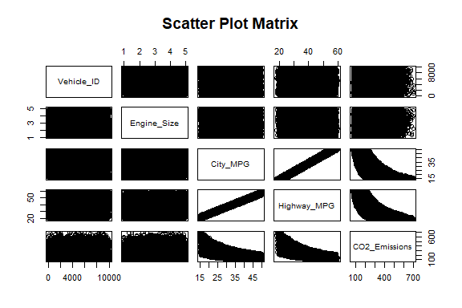<!-- -->

## ANOVA

``` r
# ANOVA for CO2 Emissions by Cylinders
anova_cylinders <- aov(CO2_Emissions ~ Cylinders, data = vehicle_data)
summary(anova_cylinders)
```

    ##               Df    Sum Sq Mean Sq F value Pr(>F)  
    ## Cylinders      3     98829   32943   2.551 0.0538 .
    ## Residuals   9996 129076106   12913                 
    ## ---
    ## Signif. codes:  0 '***' 0.001 '**' 0.01 '*' 0.05 '.' 0.1 ' ' 1

``` r
# ANOVA for CO2 Emissions by Fuel Type
anova_fuel_type <- aov(CO2_Emissions ~ Fuel_Type, data = vehicle_data)
summary(anova_fuel_type)
```

    ##               Df    Sum Sq Mean Sq F value Pr(>F)
    ## Fuel_Type      2      6940    3470   0.269  0.764
    ## Residuals   9997 129167995   12921

``` r
# Two-way ANOVA for CO2 Emissions by Cylinders and Fuel Type
anova_two_way <- aov(CO2_Emissions ~ Cylinders * Fuel_Type, data = vehicle_data)
summary(anova_two_way)
```

    ##                       Df    Sum Sq Mean Sq F value Pr(>F)  
    ## Cylinders              3     98829   32943   2.550 0.0539 .
    ## Fuel_Type              2      8058    4029   0.312 0.7321  
    ## Cylinders:Fuel_Type    6     36845    6141   0.475 0.8272  
    ## Residuals           9988 129031203   12919                 
    ## ---
    ## Signif. codes:  0 '***' 0.001 '**' 0.01 '*' 0.05 '.' 0.1 ' ' 1

``` r
# Diagnostic plots for ANOVA models
par(mfrow = c(2, 2)) # Set up the plotting area for multiple plots
plot(anova_cylinders)
```

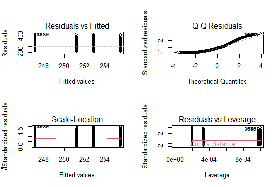<!-- -->

``` r
plot(anova_fuel_type)
```

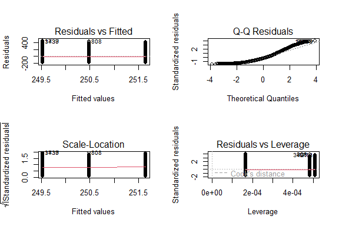<!-- -->

``` r
plot(anova_two_way)
```

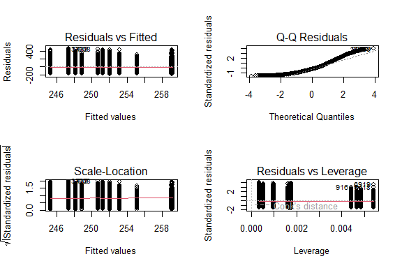<!-- -->

``` r
par(mfrow = c(1, 1)) # Reset plotting area
```

## Plots

``` r
library(ggplot2)

# Boxplots to visualize the differences
ggplot(vehicle_data, aes(x = Cylinders, y = CO2_Emissions)) + 
  geom_boxplot() +
  labs(title = "CO2 Emissions by Cylinders", x = "Cylinders", y = "CO2 Emissions")
```

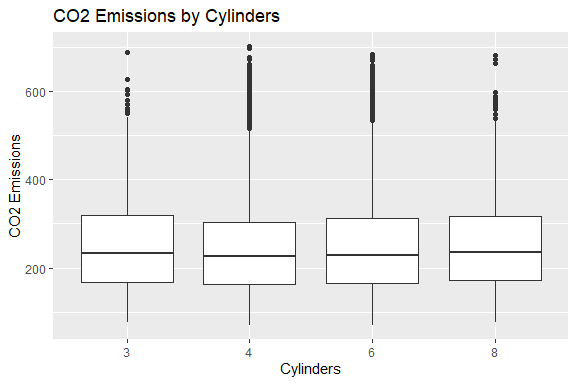<!-- -->

``` r
ggplot(vehicle_data, aes(x = Fuel_Type, y = CO2_Emissions)) + 
  geom_boxplot() +
  labs(title = "CO2 Emissions by Fuel Type", x = "Fuel Type", y = "CO2 Emissions")
```

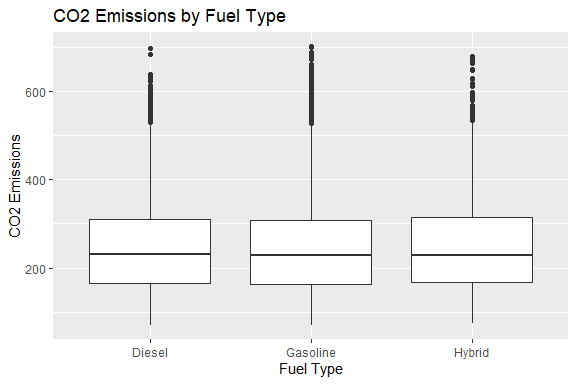<!-- -->

``` r
ggplot(vehicle_data, aes(x = Cylinders, y = CO2_Emissions, fill = Fuel_Type)) + 
  geom_boxplot() +
  labs(title = "CO2 Emissions by Cylinders and Fuel Type", x = "Cylinders", y = "CO2 Emissions")
```

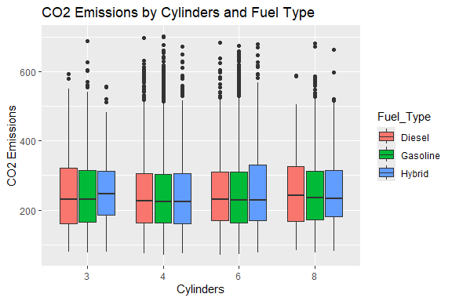<!-- -->

``` r
# Univariate Plots

# Histograms
p1 <- ggplot(vehicle_data, aes(x = Engine_Size)) + 
  geom_histogram(binwidth = 0.5, fill = "blue", color = "black") + 
  labs(title = "Histogram of Engine Size", x = "Engine Size", y = "Frequency")

p2 <- ggplot(vehicle_data, aes(x = City_MPG)) + 
  geom_histogram(binwidth = 2, fill = "green", color = "black") + 
  labs(title = "Histogram of City MPG", x = "City MPG", y = "Frequency")

p3 <- ggplot(vehicle_data, aes(x = Highway_MPG)) + 
  geom_histogram(binwidth = 2, fill = "purple", color = "black") + 
  labs(title = "Histogram of Highway MPG", x = "Highway MPG", y = "Frequency")

p4 <- ggplot(vehicle_data, aes(x = CO2_Emissions)) + 
  geom_histogram(binwidth = 10, fill = "red", color = "black") + 
  labs(title = "Histogram of CO2 Emissions", x = "CO2 Emissions", y = "Frequency")

# Boxplots
p5 <- ggplot(vehicle_data, aes(y = Engine_Size)) + 
  geom_boxplot(fill = "blue", color = "black") + 
  labs(title = "Boxplot of Engine Size", y = "Engine Size")

p6 <- ggplot(vehicle_data, aes(y = City_MPG)) + 
  geom_boxplot(fill = "green", color = "black") + 
  labs(title = "Boxplot of City MPG", y = "City MPG")

p7 <- ggplot(vehicle_data, aes(y = Highway_MPG)) + 
  geom_boxplot(fill = "purple", color = "black") + 
  labs(title = "Boxplot of Highway MPG", y = "Highway MPG")

p8 <- ggplot(vehicle_data, aes(y = CO2_Emissions)) + 
  geom_boxplot(fill = "red", color = "black") + 
  labs(title = "Boxplot of CO2 Emissions", y = "CO2 Emissions")

library(gridExtra)
# Arrange histograms and boxplots
grid.arrange(p1, p2, p3, p4, nrow = 2, ncol = 2)
```

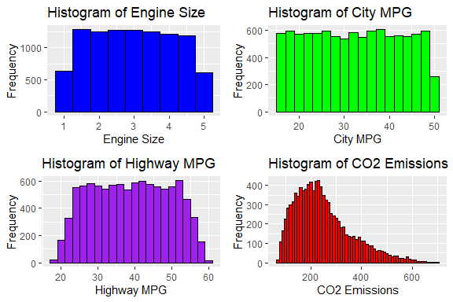<!-- -->

``` r
grid.arrange(p5, p6, p7, p8, nrow = 2, ncol = 2)
```

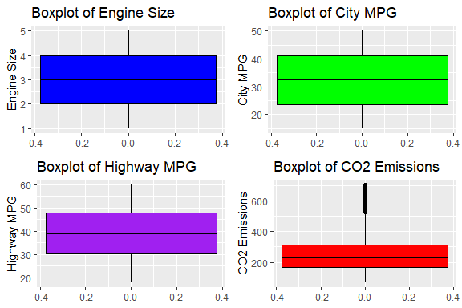<!-- -->

``` r
# Multivariate Plots

# Scatter plots
p9 <- ggplot(vehicle_data, aes(x = Engine_Size, y = CO2_Emissions)) + 
  geom_point(color = "blue") + 
  labs(title = "Scatter Plot of CO2 Emissions vs Engine Size", x = "Engine Size", y = "CO2 Emissions")

p10 <- ggplot(vehicle_data, aes(x = City_MPG, y = CO2_Emissions)) + 
  geom_point(color = "green") + 
  labs(title = "Scatter Plot of CO2 Emissions vs City MPG", x = "City MPG", y = "CO2 Emissions")

p11 <- ggplot(vehicle_data, aes(x = Highway_MPG, y = CO2_Emissions)) + 
  geom_point(color = "purple") + 
  labs(title = "Scatter Plot of CO2 Emissions vs Highway MPG", x = "Highway MPG", y = "CO2 Emissions")

# Interaction plots
p12 <- ggplot(vehicle_data, aes(x = Cylinders, y = CO2_Emissions, color = Fuel_Type)) + 
  geom_boxplot() + 
  labs(title = "Interaction Plot of CO2 Emissions by Cylinders and Fuel Type", x = "Cylinders", y = "CO2 Emissions")

library(GGally)
```

    ## Registered S3 method overwritten by 'GGally':
    ##   method from   
    ##   +.gg   ggplot2

``` r
# Pair plots (scatterplot matrix)
pairs_data <- vehicle_data[, sapply(vehicle_data, is.numeric)]
p13 <- ggpairs(pairs_data)

# Arrange scatter plots and interaction plot
grid.arrange(p9, p10, p11, p12, nrow = 2, ncol = 2)
```

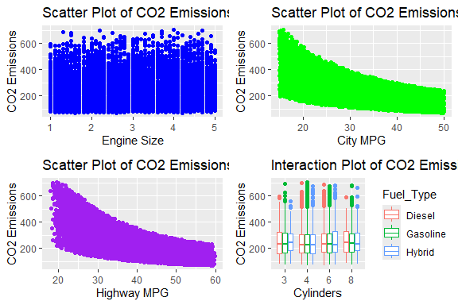<!-- -->

``` r
# Display pair plots
print(p13)
```

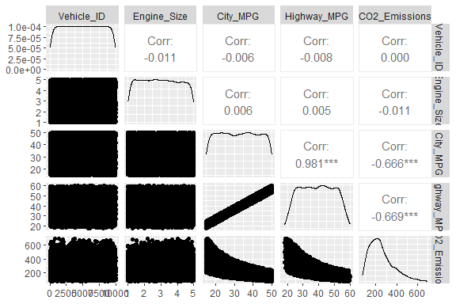<!-- -->

# Preprocessing and Data Transformation

## Missing Values

``` r
# Check for missing values
missing_values <- sum(is.na(vehicle_data))

# Display summary of missing values
print(paste("Number of missing values:", missing_values))
```

    ## [1] "Number of missing values: 0"

``` r
# Summary of missing values by column
print(summary(is.na(vehicle_data)))
```

    ##  Vehicle_ID      Engine_Size     Cylinders       Fuel_Type      
    ##  Mode :logical   Mode :logical   Mode :logical   Mode :logical  
    ##  FALSE:10000     FALSE:10000     FALSE:10000     FALSE:10000    
    ##   City_MPG       Highway_MPG     CO2_Emissions  
    ##  Mode :logical   Mode :logical   Mode :logical  
    ##  FALSE:10000     FALSE:10000     FALSE:10000

``` r
vehicle_data <- vehicle_data[, -1]

write.csv(vehicle_data, file = "modified_vehicle_dataset.csv", row.names = FALSE)
```

# Training Model

## Data Splitting

``` r
# Load required package
library(caret)
```

    ## Loading required package: lattice

``` r
# Split data into training and testing sets
set.seed(123) # for reproducibility
trainIndex <- createDataPartition(vehicle_data$CO2_Emissions, p = .7, 
                                  list = FALSE, 
                                  times = 1)
trainData <- vehicle_data[trainIndex, ]
testData <- vehicle_data[-trainIndex, ]
# Print the dimensions of the training and testing sets
print("Dimensions of Training Data:")
```

    ## [1] "Dimensions of Training Data:"

``` r
print(dim(trainData))
```

    ## [1] 7002    6

``` r
print("Dimensions of Testing Data:")
```

    ## [1] "Dimensions of Testing Data:"

``` r
print(dim(testData))
```

    ## [1] 2998    6

## Bootstrapping

``` r
# Bootstrapping
set.seed(123) # for reproducibility
boot_samples <- createResample(trainData$CO2_Emissions, times = 1000)

# Example of using bootstrap samples to calculate mean and its confidence interval
boot_means <- sapply(boot_samples, function(indices) {
  mean(trainData$CO2_Emissions[indices])
})

# Calculate the bootstrap confidence interval
boot_mean <- mean(boot_means)
boot_ci <- quantile(boot_means, c(0.025, 0.975))

print(paste("Bootstrap Mean:", boot_mean))
```

    ## [1] "Bootstrap Mean: 250.124045558412"

``` r
print(paste("Bootstrap 95% CI:", boot_ci))
```

    ## [1] "Bootstrap 95% CI: 247.315124250214" "Bootstrap 95% CI: 252.947843473293"

## Cross-Validation

``` r
# k-Fold Cross-Validation
set.seed(123) # for reproducibility
train_control <- trainControl(method = "cv", number = 10) # 10-fold cross-validation

# Train the model using k-fold cross-validation
model_cv <- train(CO2_Emissions ~ Engine_Size + Cylinders + Fuel_Type + City_MPG + Highway_MPG, 
                  data = trainData, 
                  method = "lm", 
                  trControl = train_control)

# Print cross-validation results
print(model_cv)
```

    ## Linear Regression 
    ## 
    ## 7002 samples
    ##    5 predictor
    ## 
    ## No pre-processing
    ## Resampling: Cross-Validated (10 fold) 
    ## Summary of sample sizes: 6300, 6303, 6302, 6303, 6301, 6303, ... 
    ## Resampling results:
    ## 
    ##   RMSE      Rsquared   MAE     
    ##   84.42793  0.4475905  68.74679
    ## 
    ## Tuning parameter 'intercept' was held constant at a value of TRUE

``` r
# Predict on the test data
predictions_cv <- predict(model_cv, testData)

# Evaluate model performance
rmse_cv <- sqrt(mean((testData$CO2_Emissions - predictions_cv)^2))
r_squared_cv <- cor(predictions_cv, testData$CO2_Emissions)^2

print(paste("RMSE:", rmse_cv))
```

    ## [1] "RMSE: 84.0145289140132"

``` r
print(paste("R-squared:", r_squared_cv))
```

    ## [1] "R-squared: 0.455922355440192"

## Train Different Models

``` r
# Load necessary libraries
library(caret)
library(e1071) # For SVM


# k-Fold Cross-Validation
set.seed(123) # for reproducibility
train_control <- trainControl(method = "cv", number = 10) # 10-fold cross-validation

# Train linear regression model
model_lm <- train(CO2_Emissions ~ ., 
                  data = vehicle_data, 
                  method = "lm", 
                  trControl = train_control)

# Train decision tree regression model
model_tree <- train(CO2_Emissions ~ ., 
                    data = vehicle_data, 
                    method = "rpart", 
                    trControl = train_control)


# Print cross-validation results for all models
print("Linear Regression:")
```

    ## [1] "Linear Regression:"

``` r
print(model_lm)
```

    ## Linear Regression 
    ## 
    ## 10000 samples
    ##     5 predictor
    ## 
    ## No pre-processing
    ## Resampling: Cross-Validated (10 fold) 
    ## Summary of sample sizes: 9000, 9000, 9000, 9000, 9000, 8999, ... 
    ## Resampling results:
    ## 
    ##   RMSE      Rsquared   MAE     
    ##   84.30804  0.4504288  68.79622
    ## 
    ## Tuning parameter 'intercept' was held constant at a value of TRUE

``` r
print("")
```

    ## [1] ""

``` r
print("Decision Tree Regression:")
```

    ## [1] "Decision Tree Regression:"

``` r
print(model_tree)
```

    ## CART 
    ## 
    ## 10000 samples
    ##     5 predictor
    ## 
    ## No pre-processing
    ## Resampling: Cross-Validated (10 fold) 
    ## Summary of sample sizes: 9000, 9000, 9001, 9000, 9000, 8999, ... 
    ## Resampling results across tuning parameters:
    ## 
    ##   cp          RMSE       Rsquared   MAE     
    ##   0.04238858   86.60750  0.4185083  70.58562
    ##   0.04522667   89.86174  0.3754295  72.32008
    ##   0.36720075  102.74023  0.3518147  81.47606
    ## 
    ## RMSE was used to select the optimal model using the smallest value.
    ## The final value used for the model was cp = 0.04238858.

``` r
print("")
```

    ## [1] ""

## Performance Comparison

``` r
# Compare model performance using resamples
resamps <- resamples(list(LinearRegression = model_lm, 
                          DecisionTree = model_tree))

# Summarize the results
summary(resamps)
```

    ## 
    ## Call:
    ## summary.resamples(object = resamps)
    ## 
    ## Models: LinearRegression, DecisionTree 
    ## Number of resamples: 10 
    ## 
    ## MAE 
    ##                      Min.  1st Qu.   Median     Mean  3rd Qu.     Max. NA's
    ## LinearRegression 67.78480 68.07649 68.62250 68.79622 69.37898 70.30161    0
    ## DecisionTree     65.73668 69.93524 71.14195 70.58562 71.61781 72.73459    0
    ## 
    ## RMSE 
    ##                      Min.  1st Qu.   Median     Mean  3rd Qu.     Max. NA's
    ## LinearRegression 83.08054 83.46176 84.02665 84.30804 85.21045 85.98527    0
    ## DecisionTree     80.10295 86.33901 87.23916 86.60750 88.11254 88.83343    0
    ## 
    ## Rsquared 
    ##                       Min.   1st Qu.    Median      Mean   3rd Qu.      Max.
    ## LinearRegression 0.4244359 0.4462971 0.4550388 0.4504288 0.4595840 0.4694221
    ## DecisionTree     0.3659109 0.3819142 0.4175392 0.4185083 0.4560229 0.4696594
    ##                  NA's
    ## LinearRegression    0
    ## DecisionTree        0

## Saving Model

``` r
# Saving the linear regression model
saveRDS(model_lm, file = "./models/linear_regression_model.rds")

# Load the saved linear regression model
loaded_linear_regression_model <- readRDS("./models/linear_regression_model.rds")

# Prepare new data for prediction
new_data <- data.frame(
  Vehicle_ID = 1,
  Engine_Size = c(2.0, 2.5, 1.8),  # Example Engine_Size values
  Cylinders = c("4", "6", "4"),  # Example Cylinders values
  Fuel_Type = c("Gasoline", "Diesel", "Gasoline"),  # Example Fuel_Type values
  City_MPG = c(25, 20, 28),  # Example City_MPG values
  Highway_MPG = c(32, 28, 35)  # Example Highway_MPG values
)

# Use the loaded model to make predictions for new data
predictions_loaded_model <- predict(loaded_linear_regression_model, newdata = new_data)

# Print predictions
print(predictions_loaded_model)
```

    ##        1        2        3 
    ## 301.9389 339.6774 279.6659
